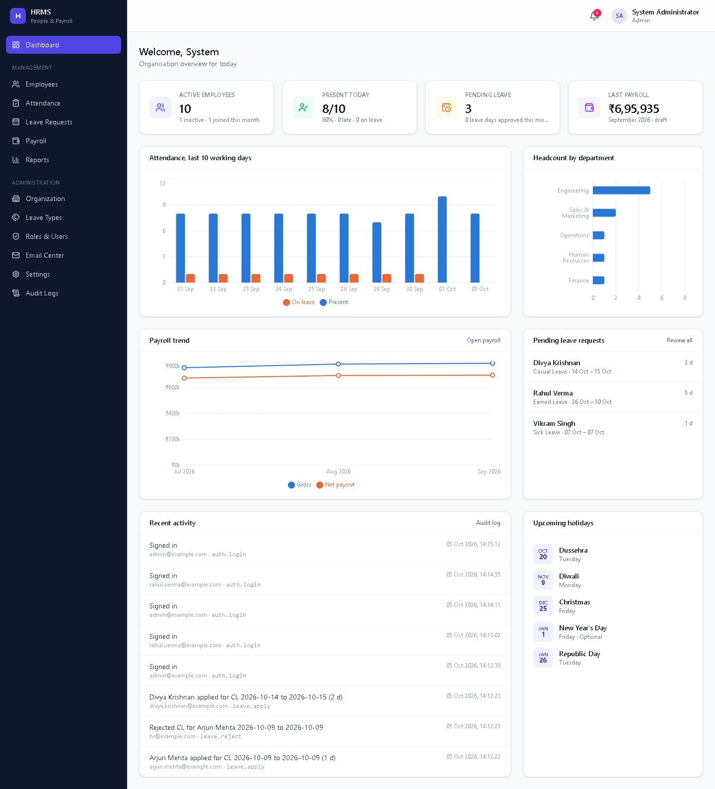

# HRMS: Human Resource Management System

A full-stack HRMS covering employee onboarding, attendance, leave, payroll, PDF salary slips, email
notifications, reports and audit logs, with JWT authentication and database-driven role-based access control.

| Layer | Stack |
|---|---|
| Backend | Python 3.10+, FastAPI, SQLAlchemy 2, Alembic, Pydantic v2, PyJWT, bcrypt, ReportLab, Jinja2 |
| Database | MySQL 8/9 (SQLite fallback for quick local runs and tests) |
| Frontend | React 19, Vite, Tailwind CSS 4, TanStack Query, React Router, React Hook Form, Recharts |



---

## Contents
1. [Quick start](#quick-start)
2. [Demo credentials](#demo-credentials)
3. [Deliverables](#deliverables)
4. [Features](#features)
5. [Business rules](#business-rules)
6. [Security](#security)
7. [Architecture](#architecture)
8. [API overview](#api-overview)
9. [Testing](#testing)

---

## Quick start

### Prerequisites
* Python 3.10+, Node.js 18+, MySQL 8+ (MySQL Server 9.0 was used during development)

### 1. Database
```sql
CREATE DATABASE hrms_db CHARACTER SET utf8mb4 COLLATE utf8mb4_unicode_ci;
```

### 2. Backend
```bash
cd BackEnd
python -m venv venv
venv\Scripts\activate            # macOS/Linux: source venv/bin/activate
pip install -r requirements.txt
copy .env.example .env           # macOS/Linux: cp .env.example .env
```
Edit `BackEnd/.env`:
* `DATABASE_URL=mysql+pymysql://root:<password>@localhost:3306/hrms_db?charset=utf8mb4` (URL-encode special characters, e.g. `@` -> `%40`)
* `JWT_SECRET_KEY=` a long random string: `python -c "import secrets; print(secrets.token_urlsafe(48))"`
* SMTP settings are optional (see [Notifications](#notifications)).

Create the schema and load demo data, then start the API:
```bash
alembic upgrade head             # tables, indexes, FKs, audit-log triggers
python -m app.seed               # roles, permissions, settings, templates + demo dataset
uvicorn app.main:app --reload --port 8000
```
* Swagger UI: http://localhost:8000/docs (ReDoc: `/redoc`)
* Health check: http://localhost:8000/health

> `python -m app.seed --reset` rebuilds the database from scratch; `--base` seeds only reference data and the admin account.
> Alternatively, import the ready-made dump: `mysql -u root -p hrms_db < DataBase/hrms_dump.sql`.

### 3. Frontend
```bash
cd FrontEnd
npm install
npm run dev                      # http://localhost:5173 (proxies /api to :8000)
```
Production build: `npm run build` (output in `FrontEnd/dist`).

---

## Demo credentials

| Role | Email | Password |
|---|---|---|
| Admin | `admin@example.com` | `Admin@123` |
| HR | `hr@example.com` | `Hr@12345` |
| Employee | `rahul.verma@example.com` | `Employee@123` |

All other seeded employees (`karthik.reddy@`, `ananya.iyer@`, `sneha.patil@`, `vikram.singh@`, `meera.nair@`,
`arjun.mehta@`, `divya.krishnan@`, `neha.kapoor@example.com`) use `Employee@123`. `rohan.gupta@` is deactivated.
The login page has one-click buttons that fill these in.

**What the demo data contains** (relative to the seeding date): 11 employees in 5 departments; attendance since
1 July, including late arrivals, half days, a missed check-out, unexplained absences and one HR correction;
approved, pending, rejected and LOP leave, including a request that exceeded its balance; a mid-month
joiner and a mid-month exit; payroll for **July and August locked and credited**; and **September as a draft**
with a manual bonus adjustment, ready for you to review, lock and credit. The Employee demo account has
**not** checked in today, so you can try check-in.

---

## Deliverables

| Item | Location |
|---|---|
| Source code (backend + frontend) | `BackEnd/`, `FrontEnd/` |
| Database schema (MySQL DDL) | [`DataBase/schema.sql`](DataBase/schema.sql) |
| Database dump (schema + demo data) | [`DataBase/hrms_dump.sql`](DataBase/hrms_dump.sql) |
| ER diagram | [`docs/er_diagram.md`](docs/er_diagram.md) (Mermaid) |
| Postman collection + environment | [`docs/HRMS.postman_collection.json`](docs/HRMS.postman_collection.json), [`docs/HRMS.postman_environment.json`](docs/HRMS.postman_environment.json) |
| UI screenshots (Admin & Employee) | [`docs/screenshots/`](docs/screenshots) |
| Sample salary slip PDF | [`docs/sample_salary_slip.pdf`](docs/sample_salary_slip.pdf) |
| Sample credentials | [above](#demo-credentials) |

Regenerate them at any time:
```bash
cd BackEnd
python scripts/export_db.py          # schema.sql, hrms_dump.sql (uses mysqldump when DATABASE_URL is MySQL), er_diagram.md
python scripts/generate_postman.py   # Postman collection from the live OpenAPI schema
cd ../FrontEnd && npm run screenshots   # needs both servers running; uses the installed Edge/Chrome
```

### Postman
Import the collection (and optionally the environment), run **Auth > Login (Admin)**, **Login (HR)** or
**Login (Employee)**, and every other request is authorised automatically. A test script stores the JWT
in `{{accessToken}}`, and Postman keeps the refresh cookie, so **Auth > Refresh** works too.

---

## Features

### Authentication & roles
* Email/password login returning a **short-lived JWT access token** (30 min) plus a **rotating refresh token** in an HttpOnly, SameSite=Strict cookie.
* Refresh-token **reuse detection**: replaying a rotated token revokes every session of that user.
* Logout, change password and password changes **revoke all sessions** (server-side token versioning).
* Forgot/reset password via single-use, hashed, expiring email links; new hires get a set-password link.
* Account **lockout** after 5 failed logins (15 min); generic error messages prevent user enumeration.
* **Role & permission management**: 25 fine-grained permissions grouped by module; Admin / HR / Employee
  system roles plus custom roles; admins edit role permissions and assign roles to users from the UI.
  Admin is always all-powerful, and the last active admin cannot be demoted.

### Employee onboarding & management
* Onboarding creates the login account, profile, salary structure and pro-rated leave balances, then sends a welcome email.
* Profiles cover personal, job (department, designation, manager, joining date, type), bank and statutory details,
  with server-side validation (formats for PAN/IFSC/phone, ages, dates, reporting cycles, duplicates).
* Search, filter and paginate the directory; edit profiles (field-level diffs land in the audit log).
* **Deactivate / reactivate** (soft delete): blocks login, revokes sessions and cancels pending leave, while all history is kept.
* **Salary structure history**: revisions with effective dates; payroll uses the structure in force for the month.
* **Document upload**: ID proofs, offer letters and so on, uploaded by HR or the employee (see [Security](#security)).

### Attendance
* One-click **check-in/check-out** with a live timer; duplicate check-ins are rejected (409) and also blocked by
  a unique `(employee_id, work_date)` constraint.
* Worked hours are calculated automatically, with day classification (present / half day / absent, thresholds configurable) and late marking.
* **Daily board**: live status of everyone (present, late, on leave, not checked in).
* **Monthly summary** per employee (working days, present, half days, paid leave, absences, LOP, late, hours, attendance %) and a calendar view.
* **Admin override**: create or correct any day with a mandatory reason. The change is flagged on the record, audited
  with before/after values, and blocked once that month's payroll is locked.

### Leave
* Configurable leave types (CL, SL, EL with carry-forward, unpaid LOP), annual quotas, colours.
* Live preview while applying: working days (weekends and holidays skipped), available balance, estimated LOP.
* Half-day leave, overlap prevention, back-dating window, no self-approval, cancellation with balance restore.
* Approve/reject with comments; balances adjust automatically, and manual allocation adjustments are audited.
* Complete leave history for employees and HR.

### Payroll & salary slips
* Monthly payroll from attendance + approved leave, run only for completed months.
* **Draft -> Locked -> Paid** lifecycle: drafts can be recalculated and given **manual adjustments**
  (earnings/deductions with reasons). **Locking** freezes the month: attendance, leave, holidays, salary revisions
  and adjustments for it are rejected with HTTP 423.
* Locking generates **PDF salary slips** (employee details, earnings, deductions, LOP, net pay in words) and emails each employee.
* **Salary credit simulation**: each payslip gets a transaction reference; employees without bank details fail and can be retried.
* Payroll history per employee; employees see only payslips from locked runs; admins see all.

### Notifications
* Template-based emails (sandboxed Jinja2, editable in **Admin > Email Center** with preview) for onboarding,
  leave applied (to approvers + confirmation), leave approved/rejected, salary slip generated, payroll processed/credited, and password reset.
* Every email is written to `email_logs`, with secret links redacted. Emails are queued and sent **only after the
  database transaction commits**, so a failed action never emails anyone.
* With `SMTP_HOST` empty (default) emails are rendered and logged (`logged` status), and in development the
  action links are printed to the server console. Set SMTP variables to deliver for real (e.g. Mailtrap or a Gmail app password).
* In-app notification bell mirrors key events.

### Admin panel, reports & audit
* Dashboard: headcount by department, today's attendance, 10-day attendance trend, pending leave, payroll trend, recent activity, holidays.
* Reports: attendance summary, daily attendance log, leave report, payroll summary, all filterable by date range and
  department, viewable in-app and **exportable to CSV or PDF** (exports are audited; CSV is protected against formula injection).
* Audit log of every critical action (logins, failed logins, onboarding, profile/salary changes, attendance
  corrections, leave decisions, payroll generate/adjust/lock/credit, role/settings/template changes, exports) with
  actor, IP, user agent, timestamp and JSON diffs. **Read-only**: there are no update/delete endpoints, and MySQL
  triggers reject `UPDATE`/`DELETE` on `audit_logs`. Filterable and exportable.
* Organisation settings: departments, designations, holiday calendar, leave types, company and payroll parameters.

---

## Business rules

**Working days** = Monday-Friday minus mandatory holidays (optional holidays remain working days).

**Day classification** (per working day): worked >= 8 h -> present (1.0); >= 4 h -> half day (0.5); otherwise
absent; checked in but no check-out on a past day -> half day. Thresholds, office start time and late grace period are settings.

**Leave & LOP**
* Paid leave consumes balance; on approval the paid part is `min(requested days, available balance)` and the
  remainder becomes **Loss of Pay**. Unpaid leave types are fully LOP.
* Joiners get pro-rated quotas (rounded to 0.5 day); EL carries forward up to 10 days.
* For a working day: `paid credit = min(1, attendance credit + paid-leave fraction)` and `LOP = 1 - paid credit`.
  So unexplained absences, short days and LOP leave all reduce pay.

**Payroll** (W = working days in month, E = working days within the employment window, L = LOP days)

| Item | Formula |
|---|---|
| Earned component | `component x E / W` (pro-rata for joiners/leavers) |
| LOP deduction | `monthly gross / W x L` |
| Paid days | `E - L` |
| Provident fund | `12% x basic x paid days / W` (if applicable) |
| Professional tax | Rs. 200 when earned gross after LOP > Rs. 15,000 (if applicable) |
| Income tax (TDS) | fixed monthly amount from the salary structure |
| Net | `gross + adj. earnings - (LOP + PF + PT + TDS + adj. deductions)`, floored at 0 |

---

## Security

| Requirement | Implementation |
|---|---|
| No plain-text passwords | bcrypt (cost 12); password policy (8+ chars, upper, lower, digit) enforced on both client and server |
| JWT on all APIs | Every endpoint except login/refresh/forgot/reset requires `Authorization: Bearer`; tokens carry type, `iss`, `exp`, `jti` and a token version |
| Session handling | Access token kept in memory only (not localStorage); refresh token in an HttpOnly cookie scoped to `/api/v1/auth`; rotation + reuse detection; logout/password change/deactivation revoke all sessions |
| Role-based API protection | `require_permissions(...)` dependency on every route; permissions loaded from the DB per request, so role changes apply immediately. Object-level checks (own payslips/documents/leave only; drafts hidden; no self-approval) |
| Input validation & errors | Strict Pydantic schemas (unknown fields rejected, trimmed strings, ranges, regex), domain validation in services, a consistent error envelope `{error: {code, message, details}}` and no stack traces leaked |
| Secure file upload | Extension allow-list **and** magic-byte check, 5 MB streaming limit, random server-side file names, path stripping, storage outside any web root, download only through authorised endpoints with `nosniff`, SHA-256 recorded |
| Other | Brute-force lockout, user-enumeration-safe responses, sandboxed email templates, secrets redacted from email logs, bank/PAN masked in audit diffs and payslips, CSV injection guard, security headers, CORS allow-list, SQL via ORM parameters only |

**Query optimisation:** indexes on every FK and filter column (status/department, work_date, leave dates,
audit created_at/entity, ...), a unique constraint for one attendance row per day, aggregate SQL for dashboards and
counts, eager loading (joined/selectin) to avoid N+1 queries, batched month calculations (one query each for
attendance, leave and holidays per month), and paginated list endpoints.

---

## Architecture

```
BackEnd/
  app/
    core/          config, database, security (JWT/bcrypt), permission catalogue, auth dependencies
    models/        SQLAlchemy models (24 tables)
    schemas/       Pydantic request/response models
    repositories/  pagination & query helpers
    services/      business logic: auth, employee, attendance, leave, payroll, report, notification, audit...
    routers/       thin FastAPI routers (auth, employees, attendance, leaves, payroll, reports, admin, ...)
    utils/         payslip PDF, CSV/PDF exporters, secure uploads, money formatting, email templates
    seed.py        reference + demo data
  migrations/      Alembic migrations (incl. MySQL audit triggers)
  scripts/         export_db.py, generate_postman.py
  tests/           pytest suite (API-level)
FrontEnd/
  src/
    api/           axios client with silent token refresh
    auth/          auth context (session restore, permission helpers)
    components/    layout, UI kit, attendance calendar, payslip viewer, documents panel, CRUD helper
    pages/         dashboard, employees, attendance, leaves, payroll, reports, admin/*
DataBase/          schema.sql, hrms_dump.sql
docs/              Postman collection, ER diagram, screenshots, sample salary slip
```

Key design choices:
* **Services own the transactions**: each command validates, mutates, writes its audit row and queues its emails, then commits once.
* **Payroll reads a single day ledger** (`attendance_service.compute_month`) that is also used by the attendance
  summary, calendar and reports, so every screen shows the same numbers that end up on the payslip.
* **Payslips snapshot** employee details at generation, so later profile edits don't rewrite history.

---

## API overview

Base URL `http://localhost:8000/api/v1`. Full interactive docs: `/docs`.

| Area | Endpoints |
|---|---|
| Auth | `POST /auth/login`, `/auth/refresh`, `/auth/logout`, `/auth/change-password`, `/auth/forgot-password`, `/auth/reset-password`, `GET /auth/me` |
| Employees | `GET/POST /employees`, `GET/PUT /employees/{id}`, `POST /employees/{id}/deactivate`, `/activate`, `/send-password-reset`, `GET/POST /employees/{id}/salary`, `GET/POST /employees/{id}/documents`, `GET .../documents/{doc}/download`, `DELETE .../documents/{doc}` |
| Self service | `GET/PUT /me/profile`, `GET /me/salary`, `GET/POST /me/documents`, `GET /me/documents/{id}/download` |
| Attendance | `POST /attendance/check-in`, `/check-out`, `GET /attendance/today`, `/attendance/me`, `/attendance/daily`, `/attendance/summary`, `/attendance/employees/{id}`, `POST /attendance/override`, `DELETE /attendance/{id}` |
| Leave | `GET/POST/PUT /leaves/types`, `GET /leaves/balances/me`, `/leaves/balances/{employee}`, `POST /leaves/balances/adjust`, `POST /leaves/preview`, `POST /leaves`, `GET /leaves/me`, `GET /leaves`, `POST /leaves/{id}/approve`, `/reject`, `/cancel` |
| Payroll | `GET/POST /payroll/runs`, `GET/DELETE /payroll/runs/{id}`, `POST /payroll/runs/{id}/regenerate`, `/lock`, `/credit`, `POST/DELETE /payroll/payslips/{id}/adjustments`, `GET /payroll/payslips`, `/payroll/payslips/me`, `/payroll/payslips/{id}`, `/payroll/payslips/{id}/pdf` |
| Reports | `GET /reports/attendance`, `/reports/attendance/daily`, `/reports/leave`, `/reports/payroll` (`?format=json|csv|pdf`) |
| Organisation | `/departments`, `/designations`, `/holidays` (CRUD), `GET/PUT /settings` |
| Administration | `/roles` (CRUD), `GET /permissions`, `GET /users`, `PUT /users/{id}/role`, `GET /audit-logs`, `/audit-logs/export`, `/email-templates`, `/email-logs` |
| Dashboard | `GET /dashboard/admin`, `GET /dashboard/employee` |
| Notifications | `GET /notifications`, `/notifications/unread-count`, `POST /notifications/{id}/read`, `/notifications/read-all` |

---

## Testing

```bash
cd BackEnd
python -m pytest -q
```
29 API-level tests run against an isolated SQLite database. They cover login, hashing, lockout, refresh rotation
and reuse detection, logout/password-change revocation, enumeration safety, RBAC and custom roles, validation,
duplicate detection, secure uploads, check-in duplicates, overrides, leave balance/LOP/cancel, self-approval, the payroll
calculation, locking (423), payslip access control, credit simulation, report exports, read-only audit logs and email logging.
